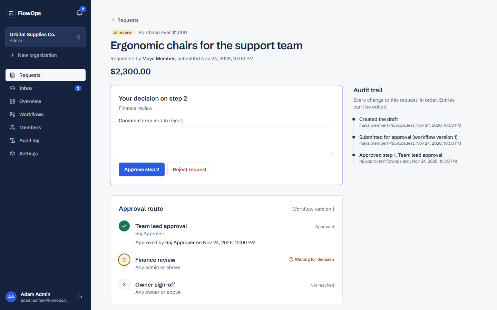
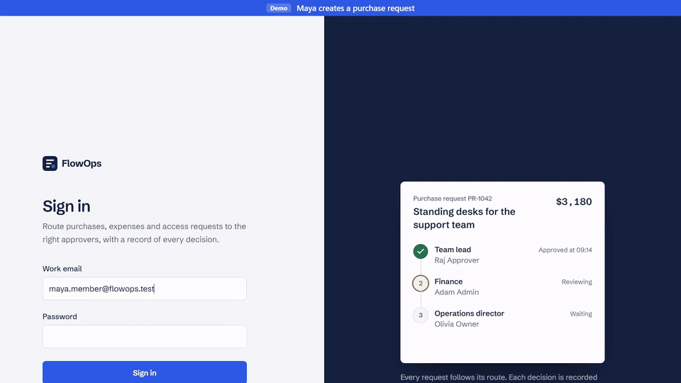
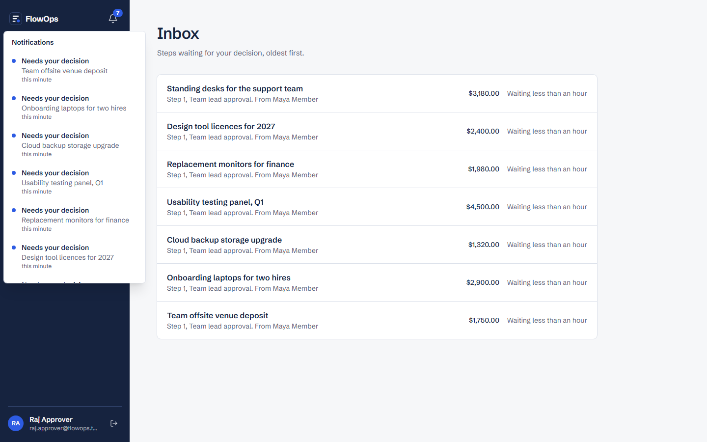
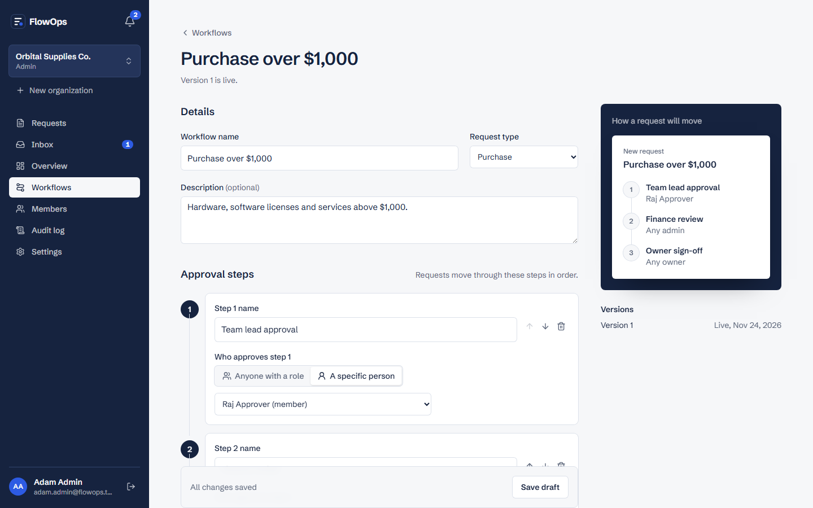
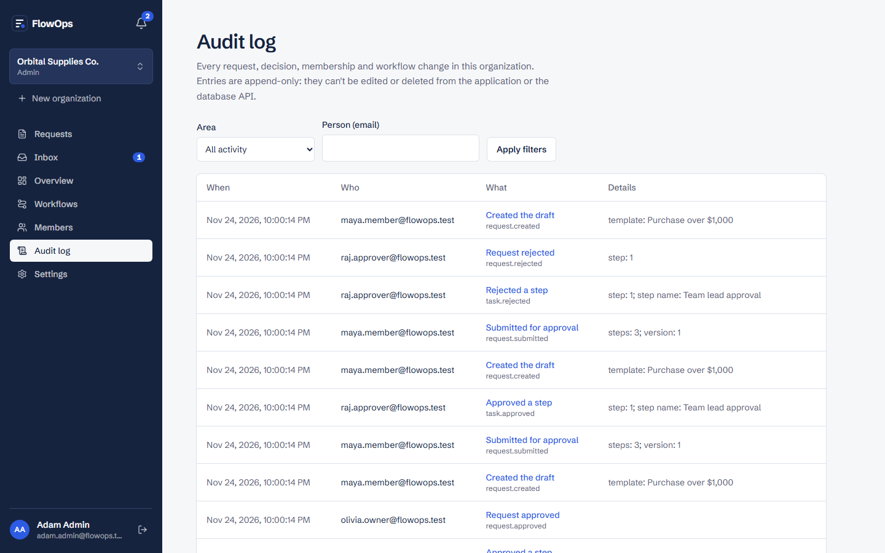
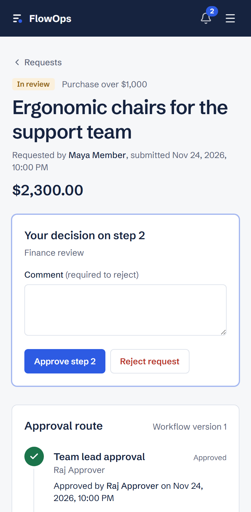
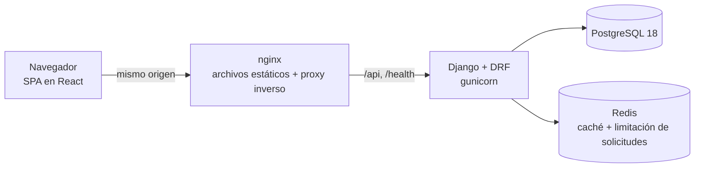
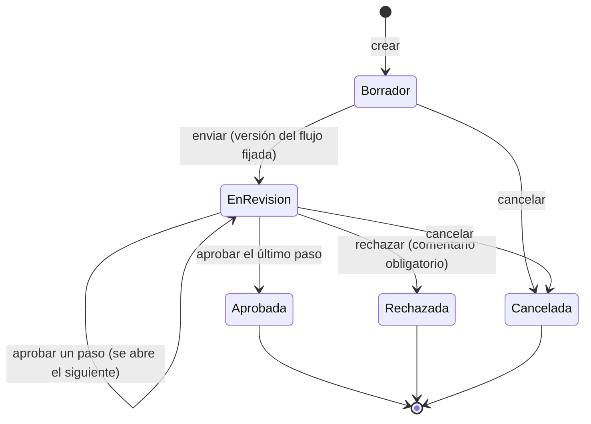

# FlowOps

[English](README.md) · **Español**

**Flujos de aprobación para equipos de operaciones.** Las solicitudes de compras, gastos y accesos
llegan a las personas adecuadas, en el orden adecuado, y cada decisión queda registrada. SaaS
multiempresa construido con Django, DRF, React y PostgreSQL.

[](https://github.com/leonardogr15/flowops/actions/workflows/ci.yml?query=branch%3Amain)
   



> **Estado: MVP completo, sin desplegar.** Todo lo que se describe aquí se ejecuta en local con un
> solo comando y está cubierto por pruebas automatizadas. No hay demo publicada, despliegue en
> producción ni usuarios reales.

## Véalo en 30 segundos



*Maya envía una solicitud; Raj (responsable de equipo), Adam (administrador) y Olivia (propietaria)
aprueban sus pasos; la solicitud termina aprobada con cada decisión registrada. Grabado con
Playwright sobre los datos de demostración; los rótulos se añaden solo para la grabación.*

| Bandeja y notificaciones | Constructor de flujos |
|---|---|
|  |  |
| **Auditoría de la organización** | **En el móvil** |
|  |  |

## Demostración en 5 minutos

Requisitos: Docker con Compose v2. `make` es opcional.

1. **Arráncalo** (construye, migra y carga datos ficticios de demostración):

   ```bash
   git clone https://github.com/leonardogr15/flowops.git
   cd flowops
   make demo
   ```

   Sin `make` (por ejemplo, en Windows sin herramientas adicionales):

   ```bash
   python scripts/make_env.py
   docker compose up -d --build --wait
   docker compose exec api python manage.py seed_demo
   ```

2. **Abre <http://localhost:8080>.** Todas las cuentas de demostración usan la contraseña guardada
   como `DEMO_PASSWORD` en el archivo `.env` creado en el paso 1.
3. **Envía una solicitud** como `maya.member@flowops.test`: *Requests → New request*, flujo
   «Purchase over $1,000», cualquier título e importe, y después *Submit for approval*.
4. **Apruébala** paso a paso: cierra sesión y entra como `raj.approver@flowops.test` (paso 1),
   después `adam.admin@flowops.test` (paso 2) y después `olivia.owner@flowops.test` (paso 3). Cada
   paso espera en la **bandeja** (*Inbox*) de esa persona.
5. **Revisa el registro**: como Maya, abre la solicitud: está aprobada y su *Audit trail* muestra cada
   paso y quién lo decidió. Como Adam, abre **Audit log** para ver toda la organización.
6. **Intenta romperlo** (opcional): como Adam, envía una solicitud y busca cómo aprobar tu propio
   paso 2; abre la misma solicitud como Adam y como Olivia en dos navegadores y decide a la vez;
   rechaza una solicitud como Raj sin comentario.

Documentación de la API: <http://localhost:8080/api/docs/>. Cuentas de demostración:

| Correo | Organización | Rol |
|---|---|---|
| `olivia.owner@flowops.test` | Orbital Supplies Co. | Propietaria |
| `adam.admin@flowops.test` | Orbital Supplies Co. | Administrador |
| `maya.member@flowops.test` | Orbital Supplies Co. | Miembro |
| `raj.approver@flowops.test` | Orbital Supplies Co. / Kestrel Analytics | Miembro / Administrador |
| `kim.owner@flowops.test` | Kestrel Analytics | Propietaria |

Las personas y empresas son ficticias. En esta demostración local, los correos de invitación se
muestran en el registro de la API (`docker compose logs api`); el diálogo de invitación también
muestra el enlace una vez.

> Los servicios de Compose son una **demostración local**: la API usa el servidor de desarrollo de
> Django con `DEBUG` activado, los puertos se publican solo en `127.0.0.1` y las cookies no llevan
> `Secure` porque se sirve HTTP sin cifrar. No es una configuración de despliegue. La imagen de
> producción (`backend/Dockerfile`, objetivo `runtime`) usa gunicorn y es la que ejecutan las pruebas
> de extremo a extremo. La administración de Django no se expone a través de nginx; en local está en
> <http://localhost:8000/admin/>.

## Aspectos técnicos destacados

- **Aislamiento multiempresa probado, no supuesto.** Cada vista de la API debe declarar si está
  limitada a una organización, y un arnés de pruebas descubre todas las rutas `/api/v1` desde la
  configuración de URL y llama a cada una con la cabecera y los identificadores de otra
  organización: cualquier respuesta distinta de `404` rompe la build.
  ([test_isolation.py](backend/apps/organizations/tests/test_isolation.py),
  [ADR-0001](docs/adr/0001-multi-tenancy.md))
- **Concurrencia demostrada sobre PostgreSQL real.** Dos aprobadores decidiendo a la vez, aprobar
  frente a rechazar, cancelar frente a aprobar y envíos dobles se ejecutan en hilos paralelos contra
  PostgreSQL; solo gana un resultado. Se comprobó que las pruebas fallan si se quitan los bloqueos
  de fila. ([test_concurrency.py](backend/apps/requests/tests/test_concurrency.py),
  [ADR-0006](docs/adr/0006-request-state-machine-and-concurrency.md))
- **Nadie aprueba su propia solicitud.** Ni siquiera una propietaria. Si ya no queda nadie que pueda
  decidir un paso, otro administrador puede hacerlo, con un comentario obligatorio que queda
  registrado como decisión de administrador.
- **Una auditoría fiable.** Los eventos se escriben en la misma transacción que el cambio, un trigger
  de PostgreSQL impide modificarlos o borrarlos, y los eventos de cada solicitud llevan un número de
  secuencia asignado bajo el bloqueo de su fila, así que el timeline mantiene el orden lógico aunque
  el reloj del servidor retroceda. ([ADR-0007](docs/adr/0007-append-only-audit-log.md),
  [test_event_order.py](backend/apps/requests/tests/test_event_order.py))
- **Un único contrato de la base de datos al navegador.** El esquema OpenAPI 3.1 se genera desde el
  código DRF, los tipos TypeScript del cliente se generan desde el esquema y la CI falla si alguno
  está desactualizado.
- **Pruebas de extremo a extremo en escritorio y móvil.** Playwright recorre con la imagen de
  producción la ruta de aprobación completa, un rechazo, un intento de autoaprobación (interfaz y
  API), dos administradores decidiendo el mismo paso a la vez, una sesión caducada y comprobaciones
  de accesibilidad con axe (contraste de color incluido).
- **Controles de seguridad en la CI.** gitleaks sobre todo el historial y una comprobación de que
  ningún token de invitación llega a los registros de los servicios en ejecución.

## Arquitectura



La vida de una solicitud, garantizada por una tabla de transiciones explícita y restricciones en la
base de datos:



Las solicitudes cerradas nunca se reabren: quien la creó puede duplicarla como borrador nuevo.

| Capa | Responsabilidad |
|---|---|
| `backend/apps/accounts` | Usuarios identificados por correo, inicio y cierre de sesión, limitación de intentos de acceso |
| `backend/apps/organizations` | Organizaciones, membresías, roles, resolución de la organización, permisos e invitaciones |
| `backend/apps/workflows` | Plantillas de flujo, versiones y pasos de aprobación |
| `backend/apps/requests` | Solicitudes, tareas de aprobación, comentarios, máquina de estados, reglas de elegibilidad y bandeja |
| `backend/apps/audit` | Eventos de auditoría de solo inserción y la API de auditoría para administradores |
| `backend/apps/notifications` | Notificaciones en la aplicación |
| `backend/common` | Errores con detalles del problema, middleware de identificadores de solicitud, registros JSON, redacción de registros y comprobaciones de funcionamiento |
| `frontend/src` | Aplicación React: cliente de API generado desde OpenAPI, contexto de sesión y organización, páginas |

En cada aplicación Django, las **vistas** solo gestionan HTTP, los **servicios** realizan escrituras
dentro de transacciones y los **selectores** realizan lecturas limitadas a la organización actual.

### Decisiones técnicas

| Decisión | Elegido | En lugar de | Por qué | ADR |
|---|---|---|---|---|
| Multiempresa | Esquema compartido, cada consulta limitada a la organización | Esquema o base de datos por organización | Una sola ruta de migraciones y operación sencilla; aislamiento demostrado por un arnés que descubre las rutas. RLS es la segunda capa prevista | [0001](docs/adr/0001-multi-tenancy.md) |
| Autenticación | Sesiones en el servidor con CSRF, SPA del mismo origen | JWT en `localStorage` o en una cookie | No hay token que un XSS pueda robar; cierre de sesión y caducidad en el servidor | [0002](docs/adr/0002-authentication.md) |
| Entorno | Django 6.1, TypeScript 5.9 con tipos de la API generados | Django 5.2 LTS; TypeScript 7 con tipos escritos a mano | Sin un salto de dos versiones mayores después; los tipos no pueden desviarse del esquema | [0003](docs/adr/0003-runtime-and-tooling-versions.md) |
| Invitaciones | Tokens de un solo uso guardados como hash; último propietario protegido con bloqueos de fila | Tokens firmados sin estado; comprobaciones optimistas | Los enlaces se pueden revocar y usar una sola vez; degradaciones simultáneas no pueden eliminar al último propietario | [0004](docs/adr/0004-invitations-and-owner-protection.md) |
| Flujos | Plantillas versionadas con pasos ordenados | Un motor BPMN genérico | Las solicitudes en curso conservan su ruta; mucho menos que operar y razonar | [0005](docs/adr/0005-versioned-workflow-templates.md) |
| Concurrencia | Bloqueos pesimistas de fila en orden fijo, `409` para pasos desactualizados | Solo bloqueo optimista | Las decisiones simultáneas se resuelven en el servidor, no en los clientes | [0006](docs/adr/0006-request-state-machine-and-concurrency.md) |
| Auditoría | Tabla de solo inserción, trigger en la BD, secuencia por solicitud | Librerías de historial de modelos, almacén de registros externo | Eventos de negocio con un orden fiable, dentro de la misma transacción | [0007](docs/adr/0007-append-only-audit-log.md) |

Los ADR están en inglés.

## Pruebas e integración continua

Últimos resultados en `main`, de la [ejecución de CI 45502673165](https://github.com/leonardogr15/flowops/actions/runs/45502673165)
(commit `b66961e`, 2026-11-24): **backend 279 aprobadas** (26 omitidas: casos del arnés de
aislamiento que llaman a una ruta con la organización del propio usuario y sin identificador de
objeto, donde no hay datos de otra organización que alcanzar), **cobertura 98,14 %** con un mínimo
del 85 %; **frontend 44 aprobadas**; **extremo a extremo 18 aprobadas** en escritorio y móvil;
escaneo de secretos limpio. La insignia de arriba muestra el estado actual.

| Conjunto de pruebas | Comando | Cobertura |
|---|---|---|
| Backend | `make test-api` | Autenticación, CSRF, limitación de solicitudes, organizaciones, matrices de permisos, aislamiento entre organizaciones, invitaciones, protección del último propietario con concurrencia, versiones de flujos, máquina de estados, decisiones simultáneas sobre PostgreSQL real, autoaprobación, decisión de administrador, trigger de auditoría, reversión y orden de eventos. Cobertura mínima: 85 % |
| Análisis estático y tipos del backend | `make lint-api` | ruff, mypy (modo estricto, con complementos de Django y DRF) |
| Frontend | `make test-web` | Inicio de sesión y caducidad de la sesión, cambio de organización, miembros y roles, invitaciones, constructor de flujos, solicitudes (crear, enviar, aprobar, rechazar, decisión simultánea perdida), bandeja, notificaciones, auditoría, comprobaciones con axe |
| Análisis estático y tipos del frontend | `make lint-web` | oxlint (las advertencias provocan fallos), TypeScript estricto |
| Extremo a extremo | `make e2e-up` y después `make e2e` | Playwright en escritorio y móvil con la imagen de producción: la ruta de aprobación con su auditoría, rechazo y duplicado, autoaprobación rechazada, decisiones simultáneas, sesión caducada, invitaciones, publicación de flujos, axe sobre las páginas reales |
| Contrato | `make schema-check` | El esquema OpenAPI versionado coincide con el código; los tipos TypeScript generados coinciden con el esquema |

`make e2e-up` levanta un proyecto Compose separado (`flowops-e2e`, con su propia base de datos) a
partir de `docker-compose.e2e.yml`, así que los datos de prueba nunca se mezclan con la demo; detén
antes la demo (`make down`), porque ambos usan los mismos puertos. `make e2e-reset` borra solo la
base de datos de extremo a extremo. Ejecuta `make web-install` una vez antes de los objetivos de
frontend y de extremo a extremo; `make help` lista todos los objetivos.

Las capturas y el GIF de este README se generan desde la aplicación en ejecución: `make screenshots`
y `make demo-gif` (sobre un entorno de extremo a extremo recién sembrado; el GIF usa un contenedor de
FFmpeg de LinuxServer.io fijado por versión y digest, solo en la máquina de desarrollo).

## Seguridad

| Control | Ubicación |
|---|---|
| Cookie de sesión con `HttpOnly`, `SameSite=Lax` y `Secure` fuera del desarrollo local | `config/settings/base.py` |
| CSRF en cada solicitud no segura, incluido el inicio de sesión | `apps/accounts/api/views.py` |
| Contraseñas con hash Argon2 y longitud mínima de 12 caracteres | `config/settings/base.py` |
| Error genérico para correo desconocido, contraseña incorrecta y usuario inactivo | `LoginView` |
| Límite de intentos de acceso por (IP del cliente, correo) y por IP para todos los correos; número de proxies de confianza para evitar la suplantación de `X-Forwarded-For`; hashes de los correos en las claves de limitación | `apps/accounts/throttles.py`, `NUM_PROXIES` |
| Las solicitudes entre organizaciones devuelven 404; las pruebas de aislamiento cubren cada ruta, incluidos identificadores de objetos de otra organización | `apps/organizations/tests/test_isolation.py` |
| Tokens de invitación: 256 bits aleatorios, guardados solo como SHA-256, de un solo uso, caducan a los 7 días y están ligados al correo invitado; reinvitar revoca el enlace anterior | `apps/organizations/members.py` |
| Los tokens de invitación nunca llegan a los registros: los registros de Django, el registro de acceso de nginx (ruta y `Referer`) y los mensajes de error muestran `[redacted]`; la CI falla si aparece un token en los registros de los servicios en ejecución | `common/redaction.py`, `frontend/nginx.conf`, `.github/workflows/ci.yml` |
| Enviar invitaciones (30 por hora) y crear organizaciones (5 por hora) tienen límite por usuario; al superarlo se responde `429` con `Retry-After` | `common/throttling.py`, `config/settings/base.py` |
| Los cambios de rol vuelven a leer al miembro que actúa y bloquean las filas de propietarios, de modo que degradaciones simultáneas no pueden dejar la organización sin propietario | `apps/organizations/members.py` |
| Las transiciones de una solicitud se ejecutan con bloqueos de fila en un orden fijo (plantilla, solicitud, tarea abierta). Las decisiones indican el paso actual y el envío la revisión actual, así que dobles clics, reintentos y decisiones simultáneas se aplican una sola vez | `apps/requests/services.py`, ADR-0006 |
| El solicitante nunca decide su propia solicitud, tampoco si es administrador o propietario; la decisión de un administrador exige un comentario y queda marcada en la auditoría | `apps/requests/policy.py` |
| Los eventos de auditoría se escriben en la misma transacción que el cambio; una protección en el modelo y un trigger de PostgreSQL impiden modificarlos o borrarlos (resistente a manipulación, no inmutable criptográficamente). Los eventos de cada solicitud se numeran bajo el bloqueo de su fila, así que el timeline conserva su orden lógico aunque el reloj del servidor retroceda | `apps/audit/`, ADR-0007 |
| La visibilidad de las solicitudes se aplica en las consultas: quien no participa recibe `404`, y se ocultan las notificaciones de solicitudes que ya no puede ver | `apps/requests/policy.py`, `apps/notifications/` |
| Las versiones publicadas de un flujo son inmutables (en los servicios y en el modelo); al publicar se comprueba de nuevo que los aprobadores siguen siendo miembros | `apps/workflows/` |
| La configuración de producción no arranca sin un `EMAIL_BACKEND` explícito, para que los enlaces de invitación nunca acaben en los registros a través del backend de consola local | `config/settings/prod.py` |
| Permisos denegados por defecto; comprobación de roles en el servidor, nunca solo en la interfaz | `apps/organizations/permissions.py` |
| Identificadores públicos UUIDv7 (sin identificadores secuenciales en las URL) | `common/models.py` |
| CSP (incluido `object-src 'none'` y sin scripts inline), `X-Frame-Options`, `nosniff` y `Referrer-Policy` en cada respuesta; la administración de Django no se enruta por el punto de entrada público | `frontend/security-headers.conf`, `frontend/nginx.conf` |
| Contenedores ejecutados sin privilegios de root; secretos únicamente mediante variables de entorno | Archivos `Dockerfile`, `.env.example` |
| Búsqueda de secretos en todo el historial de Git y el directorio de trabajo en CI | `.github/workflows/ci.yml` (gitleaks) |

Para informar de una vulnerabilidad, consulta [SECURITY.md](SECURITY.md).

## Descripción de la API

Todas las rutas están bajo `/api/v1/`. Los métodos no seguros requieren la cabecera `X-CSRFToken`.
Las rutas vinculadas a una organización requieren `X-Organization: <slug de la organización>`. La
documentación interactiva está en `/api/docs/`.

| Método y ruta | Autenticación | Limitado a una organización | Miembro | Administrador | Propietario |
|---|---|---|:-:|:-:|:-:|
| `GET /auth/csrf` | ninguna | no | – | – | – |
| `POST /auth/login` · `POST /auth/logout` · `GET /auth/me` | sesión | no | – | – | – |
| `GET /organizations` (mis organizaciones) · `POST /organizations` (crear y convertirse en propietario) | sesión | no | – | – | – |
| `GET /org` | sesión | sí | sí | sí | sí |
| `PATCH /org` (cambiar nombre) | sesión | sí | no (403) | sí | sí |
| `GET /org/members` | sesión | sí | sí | sí | sí |
| `PATCH /org/members/{id}` (rol) · `DELETE /org/members/{id}` | sesión | sí | solo abandonar | sí¹ | sí |
| `GET /org/invitations` · `POST /org/invitations` · `DELETE /org/invitations/{id}` | sesión | sí | no (403) | sí | sí |
| `GET /invitations/{token}` · `POST /invitations/{token}/accept` | el token | no | – | – | – |
| `GET /org/workflow-templates` · `GET /org/workflow-templates/{id}` | sesión | sí | solo publicados | sí | sí |
| `POST /org/workflow-templates` · `PATCH …/{id}` · `PUT …/{id}/draft` · `POST …/{id}/publish` | sesión | sí | no (403) | sí | sí |
| `GET /org/requests` (`scope`, `status`) · `GET /org/requests/{id}` | sesión | sí | propias y en las que participa² | todas | todas |
| `POST /org/requests` · `PATCH /org/requests/{id}` (borrador) · `POST …/{id}/submit` · `…/cancel`⁴ · `…/duplicate` | sesión | sí | solicitante | solicitante | solicitante |
| `POST /org/requests/{id}/approve` · `…/reject` (cuerpo: `step`, `comment`) | sesión | sí | elegible³ | elegible³ | elegible³ |
| `GET` y `POST /org/requests/{id}/comments` · `GET …/{id}/timeline` | sesión | sí | si puede verla | sí | sí |
| `GET /org/inbox`⁵ · `GET /org/notifications` · `GET …/unread` · `POST …/{id}/read` | sesión | sí | propias | propias | propias |
| `GET /org/audit-events` | sesión | sí | no (403) | sí | sí |

¹ Los administradores no pueden otorgar, cambiar ni quitar el rol de propietario; solo los
propietarios pueden. El último propietario nunca puede degradarse ni eliminarse (`409`).

² Solicitudes que el miembro creó o en las que es o fue aprobador. Las demás devuelven `404`.

³ El miembro indicado, o cualquiera con el rol del paso o superior; nunca el solicitante. Si nadie
es elegible, deciden los administradores y propietarios distintos del solicitante, con un
comentario obligatorio. Un `step` o una `revision` desactualizados devuelven `409`; enviar cuando un
paso no tiene ningún aprobador posible devuelve `422` (`urn:flowops:problem:no_eligible_approver`).

⁴ Los administradores y propietarios también pueden cancelar una solicitud en revisión cuyo
solicitante ya no es miembro, con un `reason` obligatorio que se escribe en la auditoría. Con
solicitudes de miembros activos reciben `403`.

⁵ Devuelve `{count, results, limit}`: cuenta todas las tareas abiertas que esperan tu decisión y
lista las `limit` (200) más antiguas.

Códigos de estado: `401` si no has iniciado sesión, `403` si tu rol no tiene permiso, `404` para
organizaciones a las que no perteneces (indistinguibles de las que no existen) y `400` si falta la
cabecera de organización. Los errores usan `application/problem+json`.

## Limitaciones conocidas y qué necesitaría producción

- **No está desplegado.** Producción necesitaría terminación TLS con HSTS, una configuración de
  producción más estricta (hosts y orígenes obligatorios, `manage.py check --deploy` en la CI), un
  proveedor de correo real, copias de seguridad de la base de datos, agregación de registros,
  métricas y alertas, y una limpieza programada de sesiones.
- **Las notificaciones son solo dentro de la aplicación** y se actualizan cada 30 segundos; todavía
  no hay correo ni notificaciones push.
- **El aislamiento lo aplica la aplicación.** La seguridad por fila (RLS) de PostgreSQL añadiría una
  segunda capa.
- **Los comentarios y el timeline de cada solicitud no se paginan.** Son pequeños por solicitud,
  pero no tienen un tope estricto.
- **La auditoría de la organización se ordena por tiempo**, un orden aproximado si el reloj del
  servidor retrocede; el timeline de cada solicitud tiene un orden lógico exacto.
- Todavía no hay cambio ni recuperación de contraseña, ni OIDC/SSO.

## Estructura del proyecto

```
backend/        Proyecto Django (config/, apps/, common/), openapi.yaml, Dockerfile
frontend/       Aplicación React (src/), pruebas Playwright (e2e/), configuración nginx, Dockerfile
docs/adr/       Registros de decisiones de arquitectura
docs/images/    Capturas y GIF del README (generados con make screenshots / make demo-gif)
scripts/        Scripts auxiliares para uso local
```

## Plan de desarrollo

| Hito | Alcance | Estado |
|---|---|---|
| Bases | Cuentas, organizaciones, aislamiento, permisos y estructura de la aplicación | **Completado** |
| Personas | Invitaciones por correo, gestión de miembros y protección del último propietario | **Completado** |
| Flujos de trabajo | Plantillas versionadas con pasos de aprobación ordenados | **Completado** |
| Solicitudes | Enviar, aprobar, rechazar y comentar; máquina de estados con protección ante concurrencia; registro de auditoría; notificaciones en la aplicación | **Completado** |
| Notificaciones | Notificaciones por correo | Planificado |
| Refuerzo de seguridad | Seguridad por fila en PostgreSQL, inicio de sesión con OIDC y límites de solicitudes por organización | Más adelante |

## Licencia

[MIT](LICENSE) © 2026 Leonardo Galvis
