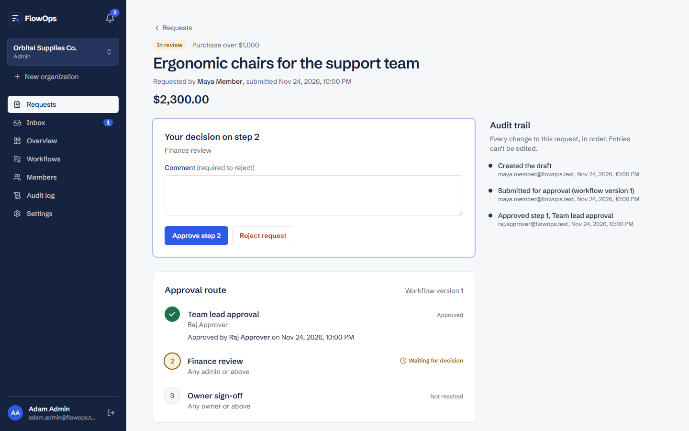
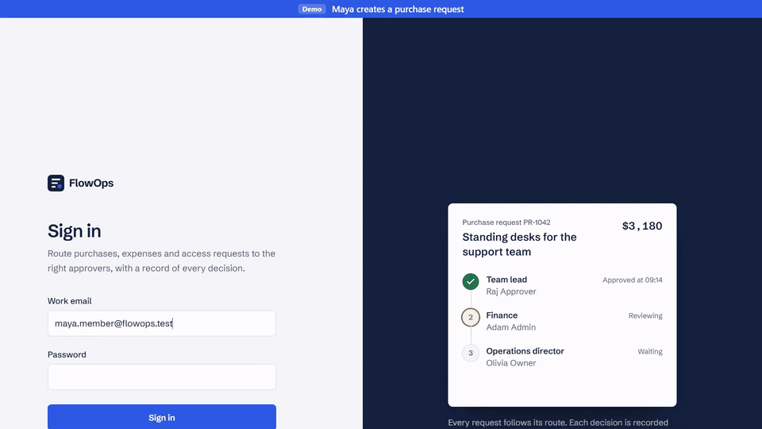
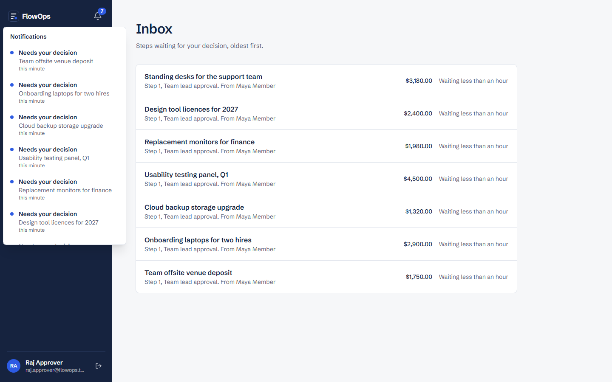
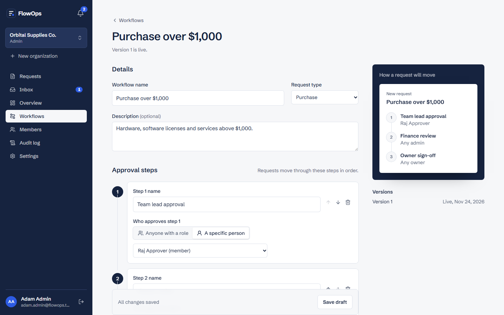
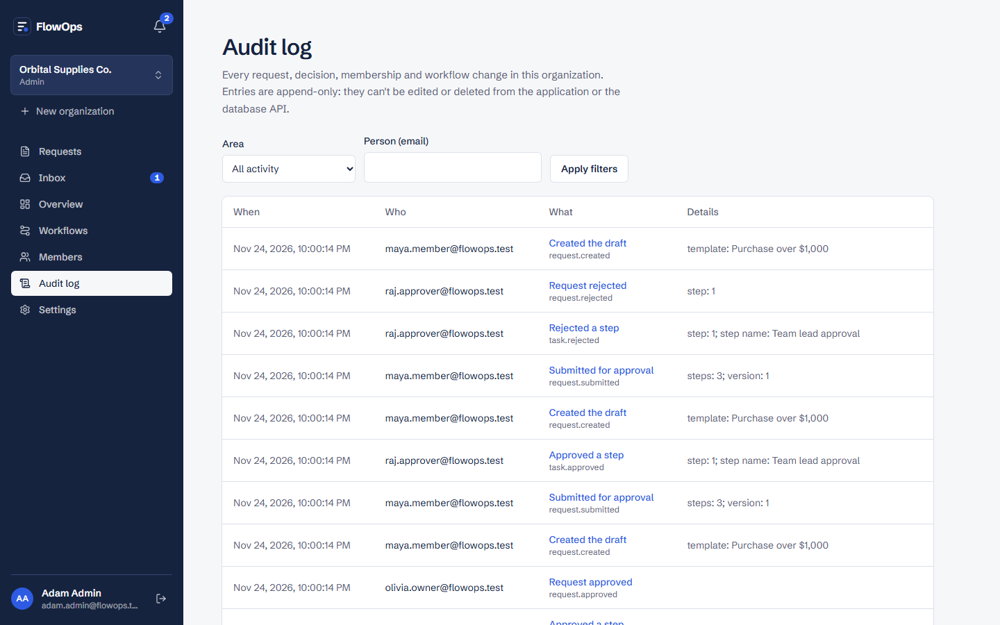
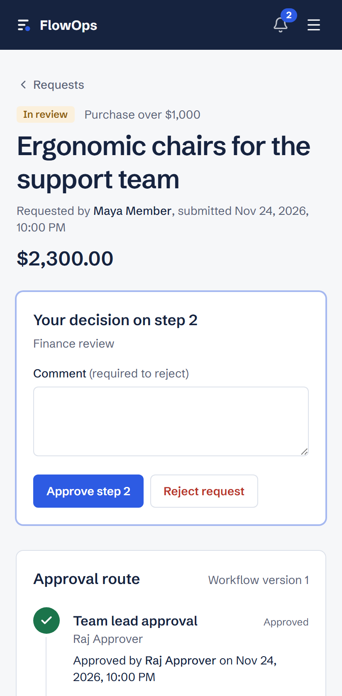
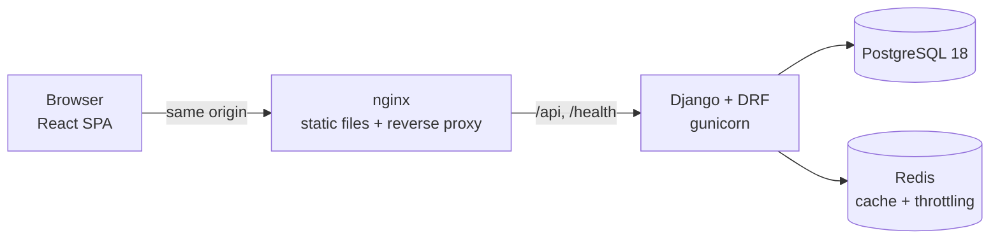
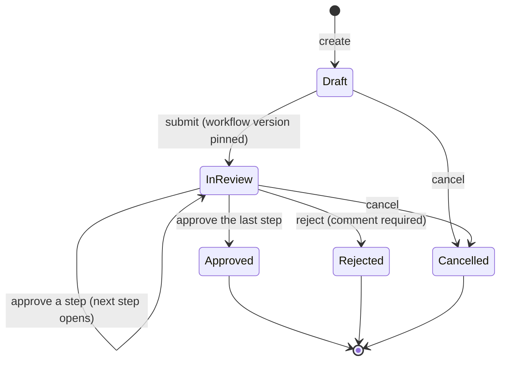

# FlowOps

**English** · [Español](README.es.md)

**Approval workflows for operations teams.** Purchases, expenses and access requests go to the right
people, in the right order, and every decision is recorded. Multi-tenant SaaS built with Django, DRF,
React and PostgreSQL.

[](https://github.com/leonardogr15/flowops/actions/workflows/ci.yml?query=branch%3Amain)
   



> **Status: feature-complete MVP, not deployed.** Everything below runs locally with one command; the
> core behaviour is covered by automated tests. There is no hosted demo, no production deployment and
> no real users.

## See it in 30 seconds



*Maya submits a request; Raj (team lead), Adam (admin) and Olivia (owner) approve their steps; the
request ends approved with every decision recorded. Recorded with Playwright on the demo data; the
blue "Demo" band is added for the recording and is not part of the app.*

| Inbox and notifications | Workflow builder |
|---|---|
|  |  |
| **Organization audit log** | **On a phone** |
|  |  |

## Demo in 5 minutes

Requirements: Docker with Compose v2. `make` is optional.

1. **Start it** (builds, migrates and seeds fictional demo data):

   ```bash
   git clone https://github.com/leonardogr15/flowops.git
   cd flowops
   make demo
   ```

   Without `make` (for example on plain Windows):

   ```bash
   python scripts/make_env.py
   docker compose up -d --build --wait
   docker compose exec api python manage.py seed_demo
   ```

2. **Open <http://localhost:8080>.** Every demo account uses the password stored as `DEMO_PASSWORD`
   in the `.env` file created in step 1.
3. **Submit a request** as `maya.member@flowops.test`: *Requests → New request*, workflow
   "Purchase over $1,000", any title and amount, *Create draft*, then *Submit for approval* and
   confirm.
4. **Approve it** step by step: sign out and sign in as `raj.approver@flowops.test` (step 1), then
   `adam.admin@flowops.test` (step 2), then `olivia.owner@flowops.test` (step 3). Each step is
   waiting in that person's **Inbox**. Raj also belongs to Kestrel Analytics: if his inbox is empty,
   switch to *Orbital Supplies Co.* with the organization menu at the top left.
5. **Check the record**: as Maya, open the request: it is approved, and its *Audit trail* lists every
   step and who decided it. As Adam, open **Audit log** for the whole organization.
6. **Try to break it** (optional): as Adam, submit a request and look for a way to approve your own
   step 2; open the same request as Adam and Olivia in two browsers and decide at the same time;
   reject a request as Raj without a comment.

API documentation: <http://localhost:8080/api/docs/>. Demo accounts:

| Email | Organization | Role |
|---|---|---|
| `olivia.owner@flowops.test` | Orbital Supplies Co. | Owner |
| `adam.admin@flowops.test` | Orbital Supplies Co. | Admin |
| `maya.member@flowops.test` | Orbital Supplies Co. | Member |
| `raj.approver@flowops.test` | Orbital Supplies Co. / Kestrel Analytics | Member / Admin |
| `kim.owner@flowops.test` | Kestrel Analytics | Owner |

People and companies are fictional. Invitation emails are printed to the API log
(`docker compose logs api`) in this local demo; the invite dialog also shows the link once.

> The Compose stack is a **local demo**: the API runs Django's development server with `DEBUG` on,
> ports are bound to `127.0.0.1`, and cookies are not marked `Secure` because it serves plain HTTP.
> It is not a deployment configuration. The production image (`backend/Dockerfile`, target
> `runtime`) uses gunicorn and is what the end-to-end tests run. The Django admin is not exposed
> through nginx; locally it is at <http://localhost:8000/admin/>.

## Engineering highlights

- **Tenant isolation that is tested, not assumed.** Every API view must declare whether it is
  tenant-scoped, and a test harness discovers all `/api/v1` routes from the URL configuration and
  calls each one with another organization's header and object ids: anything other than `404`
  fails the build. ([test_isolation.py](backend/apps/organizations/tests/test_isolation.py),
  [ADR-0001](docs/adr/0001-multi-tenancy.md))
- **Concurrency tested on real PostgreSQL.** Two approvers deciding at once, approve versus reject,
  cancel versus approve and double submits run in parallel threads against PostgreSQL; exactly one
  outcome wins. The tests were checked to fail when the row locks are removed.
  ([test_concurrency.py](backend/apps/requests/tests/test_concurrency.py),
  [ADR-0006](docs/adr/0006-request-state-machine-and-concurrency.md))
- **Nobody approves their own request.** Not even an owner. When nobody is left who can decide a
  step, another admin can, with a mandatory comment recorded as an admin decision.
- **An append-only audit trail with a reliable order.** Events are written in the same transaction as the change,
  updates and deletes are blocked by a PostgreSQL trigger, and the events of each request carry a
  sequence number assigned under the request's row lock, so the timeline stays in logical order
  even if the server clock steps back. ([ADR-0007](docs/adr/0007-append-only-audit-log.md),
  [test_event_order.py](backend/apps/requests/tests/test_event_order.py))
- **One contract from database to browser.** The OpenAPI 3.1 schema is generated from the DRF code,
  the TypeScript client types are generated from the schema, and CI fails if either is out of date.
- **End-to-end on desktop and mobile.** Playwright drives the production image through the full
  approval route, a rejection, a self-approval attempt (UI and API), two admins deciding the same step
  at the same time, an expired session, and axe accessibility checks (colour contrast included).
- **Security checks in CI.** gitleaks over the full history, and a check that no invitation token is
  ever written to the logs of the running stack.

## Architecture



A request's life, enforced by an explicit transition table and database constraints:



Closed requests are never reopened: the requester can duplicate one into a new draft.

| Layer | Responsibility |
|---|---|
| `backend/apps/accounts` | Email-based user model, session login/logout, login throttling |
| `backend/apps/organizations` | Organizations, memberships, roles, tenant resolution, permissions, invitations |
| `backend/apps/workflows` | Workflow templates, versions and approval steps |
| `backend/apps/requests` | Requests, approval tasks, comments, state machine, eligibility policy, inbox |
| `backend/apps/audit` | Append-only audit events and the admin audit API |
| `backend/apps/notifications` | In-app notifications |
| `backend/common` | Problem-details errors, request-ID middleware, JSON logging, log redaction, health checks |
| `frontend/src` | React app: API client generated from the OpenAPI schema, session and organization context, pages |

Inside each Django app, **views** handle HTTP only, **services** perform writes inside transactions,
and **selectors** perform tenant-scoped reads.

### Technical decisions

| Decision | Chosen | Instead of | Why | ADR |
|---|---|---|---|---|
| Multi-tenancy | Shared schema, every query scoped by organization | Schema or database per tenant | One migration path and simple operations; isolation proven by a route-discovering test harness. RLS is the planned second layer | [0001](docs/adr/0001-multi-tenancy.md) |
| Authentication | Server sessions with CSRF, same-origin SPA | JWT in `localStorage` or a cookie | No token for XSS to steal; logout and expiry are server-side | [0002](docs/adr/0002-authentication.md) |
| Runtime | Django 6.1, TypeScript 5.9 with generated API types | Django 5.2 LTS; TypeScript 7 with hand-written types | No two-major-version jump later; API types can't drift from the schema | [0003](docs/adr/0003-runtime-and-tooling-versions.md) |
| Invitations | Single-use tokens stored as hashes; last owner protected under row locks | Signed stateless tokens; optimistic checks | Links can be revoked and used once; concurrent demotions can't remove the last owner | [0004](docs/adr/0004-invitations-and-owner-protection.md) |
| Workflows | Versioned templates with ordered steps | A generic BPMN engine | In-flight requests keep their route; much less to run and reason about | [0005](docs/adr/0005-versioned-workflow-templates.md) |
| Concurrency | Pessimistic row locks in a fixed order, stale-step `409` | Optimistic locking only | Simultaneous decisions resolve on the server, not in clients | [0006](docs/adr/0006-request-state-machine-and-concurrency.md) |
| Audit | Append-only table, DB trigger, per-request sequence | Model-history libraries, external log store | Business events with a reliable order, inside the same transaction | [0007](docs/adr/0007-append-only-audit-log.md) |

## Testing and CI

Latest published results, from [CI run 45541509216](https://github.com/leonardogr15/flowops/actions/runs/45541509216)
on `main` (commit `402df2b`, 2026-11-25): **backend 279 passed** (26 skipped: isolation-harness cases that call a
route with the caller's own organization and no object id, where there is no other tenant's data to
reach), **98.14% coverage** with an 85% gate; **frontend 51 passed**;
**end-to-end 20 passed** on desktop and mobile, including axe accessibility checks on the real pages;
secret scan clean. The badge above shows the current status.

| Suite | Command | What it covers |
|---|---|---|
| Backend | `make test-api` | Auth, CSRF, throttling, tenancy, permission matrices, cross-tenant isolation, invitations, last-owner protection under concurrency, workflow versioning, request state machine, simultaneous decisions on real PostgreSQL, self-approval, admin fallback, audit trigger, rollback and event order. Coverage gate: 85% |
| Backend lint/types | `make lint-api` | ruff, mypy (strict, with Django and DRF plugins) |
| Frontend | `make test-web` | Sign-in and session expiry, organization switching, members and roles, invitations, workflow builder, requests (create, submit, approve, reject, lost race), inbox, notifications, audit log, axe checks |
| Frontend lint/types | `make lint-web` | oxlint (warnings fail), TypeScript strict |
| End-to-end | `make e2e-up`, then `make e2e` | Playwright on desktop and mobile against the production image: the approval route with its audit trail, rejection and duplication, self-approval refused, simultaneous decisions, expired session, invitations, workflow publishing, axe on the real pages |
| Contract | `make schema-check` | Committed OpenAPI schema matches the code; generated TypeScript types match the schema |

`make e2e-up` starts a separate Compose project (`flowops-e2e`, with its own database) from
`docker-compose.e2e.yml`, so test data never mixes with the demo; stop the demo first (`make down`),
because both use the same ports. `make e2e-reset` deletes only the end-to-end database. Run `make
web-install` once before the frontend and end-to-end targets (it also installs Playwright's
Chromium); `make help` lists every target.

The README screenshots and the GIF are generated from the running app, on a freshly seeded
end-to-end stack: `make e2e-reset e2e-up`, then `make screenshots` and `make demo-gif`. The GIF and
a local MP4 are built with a pinned FFmpeg container from LinuxServer.io, only on the developer's
machine.

## Security

| Control | Where |
|---|---|
| Session cookie `HttpOnly`, `SameSite=Lax`, `Secure` outside local dev | `config/settings/base.py` |
| CSRF on every unsafe request, including login | `apps/accounts/api/views.py` |
| Argon2 password hashing, minimum length 12 | `config/settings/base.py` |
| Generic error for unknown email, wrong password and inactive user | `LoginView` |
| Login throttling per (client IP, email) and per client IP across all emails, with a trusted proxy count so `X-Forwarded-For` can't be spoofed; emails are hashed in throttle keys | `apps/accounts/throttles.py`, `NUM_PROXIES` |
| Cross-tenant requests return 404; isolation harness covers every endpoint, including object ids from another organization | `apps/organizations/tests/test_isolation.py` |
| Invitation tokens: 256-bit random, stored only as SHA-256, single use, 7-day expiry, bound to the invited email; re-inviting revokes the previous link | `apps/organizations/members.py` |
| Invitation tokens never reach the logs: Django log lines, the nginx access log (path and `Referer`) and error messages show `[redacted]`; CI fails if a raw token appears in the running stack's logs | `common/redaction.py`, `frontend/nginx.conf`, `.github/workflows/ci.yml` |
| Sending invitations (30 per hour) and creating organizations (5 per hour) are limited per user; limits answer `429` with `Retry-After` | `common/throttling.py`, `config/settings/base.py` |
| Role changes re-read the acting member and lock owner rows, so concurrent demotions cannot remove the last owner | `apps/organizations/members.py` |
| Request transitions run under row locks in a fixed order (template, request, open task). Decisions carry the current step and submits the current revision, so double clicks, retries and simultaneous decisions apply once | `apps/requests/services.py`, ADR-0006 |
| Requesters never decide their own request, including admins and owners; admin fallback needs a comment and is flagged in the audit log | `apps/requests/policy.py` |
| Audit events are written in the same transaction as the change; a model guard and a PostgreSQL trigger block updates and deletes (tamper-resistant, not cryptographically immutable). Events of a request are numbered under the request's row lock, so the timeline keeps their logical order even if the server clock steps back | `apps/audit/`, ADR-0007 |
| Request visibility is enforced in queries: people outside a request get `404`, and notifications about requests they can no longer see are hidden | `apps/requests/policy.py`, `apps/notifications/` |
| Published workflow versions are immutable (enforced in services and in the model); publishing re-checks that approvers are still members | `apps/workflows/` |
| Production settings refuse to start without an explicit `EMAIL_BACKEND`, so invitation links are never written to logs by the local console backend | `config/settings/prod.py` |
| Deny-by-default permissions; role checks on the server, never only in the UI | `apps/organizations/permissions.py` |
| UUIDv7 public IDs (no sequential IDs in URLs) | `common/models.py` |
| CSP (including `object-src 'none'`, no inline scripts), `X-Frame-Options`, `nosniff`, `Referrer-Policy` on every response; Django admin not routed through the public entrypoint | `frontend/security-headers.conf`, `frontend/nginx.conf` |
| Containers run as non-root; secrets only via environment | `Dockerfile`s, `.env.example` |
| Secret scanning of the full git history and the working tree in CI | `.github/workflows/ci.yml` (gitleaks) |

To report a vulnerability, see [SECURITY.md](SECURITY.md).

## API overview

All endpoints are under `/api/v1/`. Unsafe methods need the `X-CSRFToken` header. Tenant-scoped
endpoints need `X-Organization: <organization slug>`. Interactive documentation is served at
`/api/docs/`.

| Method and path | Auth | Tenant-scoped | Member | Admin | Owner |
|---|---|---|:-:|:-:|:-:|
| `GET /auth/csrf` | none | no | – | – | – |
| `POST /auth/login` · `POST /auth/logout` · `GET /auth/me` | session | no | – | – | – |
| `GET /organizations` (mine) · `POST /organizations` (create, become owner) | session | no | – | – | – |
| `GET /org` | session | yes | yes | yes | yes |
| `PATCH /org` (rename) | session | yes | no (403) | yes | yes |
| `GET /org/members` | session | yes | yes | yes | yes |
| `PATCH /org/members/{id}` (role) · `DELETE /org/members/{id}` | session | yes | leave only | yes¹ | yes |
| `GET /org/invitations` · `POST /org/invitations` · `DELETE /org/invitations/{id}` | session | yes | no (403) | yes | yes |
| `GET /invitations/{token}` · `POST /invitations/{token}/accept` | the token | no | – | – | – |
| `GET /org/workflow-templates` · `GET /org/workflow-templates/{id}` | session | yes | published only | yes | yes |
| `POST /org/workflow-templates` · `PATCH …/{id}` · `PUT …/{id}/draft` · `POST …/{id}/publish` | session | yes | no (403) | yes | yes |
| `GET /org/requests` (`scope`, `status`) · `GET /org/requests/{id}` | session | yes | own and taken part in² | all | all |
| `POST /org/requests` · `PATCH /org/requests/{id}` (draft) · `POST …/{id}/submit` · `…/cancel`⁴ · `…/duplicate` | session | yes | requester | requester | requester |
| `POST /org/requests/{id}/approve` · `…/reject` (body: `step`, `comment`) | session | yes | eligible³ | eligible³ | eligible³ |
| `GET` and `POST /org/requests/{id}/comments` · `GET …/{id}/timeline` | session | yes | if visible | yes | yes |
| `GET /org/inbox`⁵ · `GET /org/notifications` · `GET …/unread` · `POST …/{id}/read` | session | yes | own | own | own |
| `GET /org/audit-events` | session | yes | no (403) | yes | yes |

¹ Admins cannot grant, change or remove the owner role; only owners can. The last owner can never be
demoted or removed (`409`).

² Requests a member created, or where they are or were an approver. Other requests get `404`.

³ The named member, or anyone with the step's role or higher; never the requester. If nobody is
eligible, admins and owners other than the requester decide with a required comment. A stale `step`
or `revision` gets `409`; submitting when a step has no possible approver gets `422`
(`urn:flowops:problem:no_eligible_approver`).

⁴ Admins and owners may also cancel a request in review whose requester is no longer a member, with a
required `reason` that is written to the audit log. For current members' requests they get `403`.

⁵ Returns `{count, results, limit}`: every open task waiting for you is counted, and the oldest
`limit` (200) are listed.

Status codes: `401` if not signed in, `403` if your role is not allowed, `404` for organizations you
don't belong to (indistinguishable from ones that don't exist), and `400` if the organization header
is missing. Errors use `application/problem+json`.

## Known limitations and what production would need

- **Not deployed.** Production would need TLS termination with HSTS, stricter production settings
  (required hosts and origins, `manage.py check --deploy` in CI), a real email provider, database
  backups, log aggregation, metrics and alerts, and a scheduled session cleanup.
- **Notifications are in-app only** and refreshed every 30 seconds; no email or push yet. They are a
  history: an assignment notice keeps its "Needs your decision" wording after the step is decided.
- **Isolation is enforced by the application.** PostgreSQL Row-Level Security would add a second
  layer.
- **Comments and request timelines are not paginated.** They are small per request, but have no
  hard cap.
- **The organization-wide audit log is ordered by time**, which is approximate if the server clock
  steps back; the per-request timeline has an exact logical order.
- No password change or reset flow, and no OIDC/SSO yet.

## Project layout

```
backend/        Django project (config/, apps/, common/), openapi.yaml, Dockerfile
frontend/       React app (src/), Playwright tests (e2e/), nginx config, Dockerfile
docs/adr/       Architecture decision records
docs/images/    README screenshots and GIF (generated with make screenshots / make demo-gif)
scripts/        Local helper scripts
```

## Roadmap

| Milestone | Scope | Status |
|---|---|---|
| Foundation | Accounts, organizations, tenancy, permissions, app shell | **Done** |
| People | Invitations by email, member management, last-owner protection | **Done** |
| Workflows | Versioned workflow templates with ordered approval steps | **Done** |
| Requests | Submit, approve, reject, comment; state machine with concurrency safety; audit trail; in-app notifications | **Done** |
| Notifications | Email notifications | Planned |
| Hardening | PostgreSQL Row-Level Security, OIDC sign-in, rate limits per tenant | Later |

## License

[MIT](LICENSE) © 2026 Leonardo Galvis
