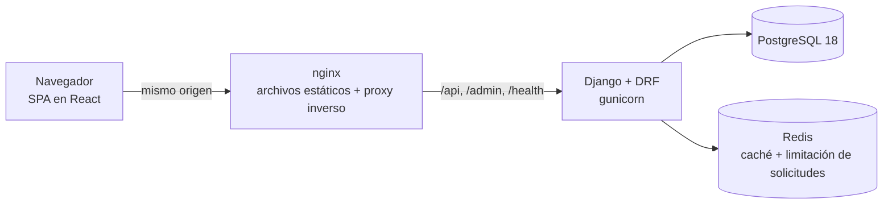

# FlowOps

Flujos de aprobación para equipos de operaciones de múltiples organizaciones: las solicitudes de compras, gastos y accesos llegan a los responsables adecuados, en orden y con un registro de cada decisión.

> **Estado: desarrollo inicial.** Esta versión incluye cuentas, organizaciones, aislamiento entre organizaciones y permisos por rol, con una aplicación web funcional. Los flujos de aprobación son el siguiente hito; consulta el [Plan de desarrollo](#plan-de-desarrollo).

   

## Funcionalidades disponibles

- **Inicio de sesión** con correo y contraseña. Sesiones en el servidor, protección CSRF (incluido el inicio de sesión) y limitación de intentos fallidos.
- **Organizaciones y roles.** Crea organizaciones, cambia entre aquellas a las que perteneces y consulta tu rol (propietario, administrador o miembro).
- **Aislamiento entre organizaciones.** Cada solicitud se ejecuta en el contexto de una organización. Las solicitudes de datos de otras organizaciones reciben un `404`.
- **Permisos por rol.** Los miembros pueden consultar; los administradores y propietarios gestionan la configuración de la organización.
- **Aplicación web.** Interfaz adaptable en React con estados de carga, ausencia de datos, error y permisos, navegación por teclado y comprobaciones automatizadas de accesibilidad.
- **Operación básica.** Rutas de comprobación de funcionamiento y disponibilidad, registros JSON con identificadores de solicitud, errores según RFC 9457 y documentación OpenAPI en `/api/docs/`.

## Arquitectura



| Capa | Responsabilidad |
|---|---|
| `backend/apps/accounts` | Usuarios identificados por correo, inicio y cierre de sesión, limitación de intentos de acceso |
| `backend/apps/organizations` | Organizaciones, membresías, roles, resolución de la organización y permisos |
| `backend/common` | Errores con detalles del problema, middleware de identificadores de solicitud, registros JSON y comprobaciones de funcionamiento |
| `frontend/src` | Aplicación React: cliente de API generado desde OpenAPI, contexto de sesión y organización, páginas |

En cada aplicación Django, las **vistas** solo gestionan HTTP, los **servicios** realizan escrituras dentro de transacciones y los **selectores** realizan lecturas limitadas a la organización actual.

### Decisiones técnicas

- [ADR-0001 Múltiples organizaciones: esquema compartido y aislamiento aplicado por la aplicación](docs/adr/0001-multi-tenancy.md)
- [ADR-0002 Autenticación: sesiones en el servidor con CSRF para una SPA del mismo origen](docs/adr/0002-authentication.md)
- [ADR-0003 Versiones del entorno de ejecución y las herramientas](docs/adr/0003-runtime-and-tooling-versions.md)

## Inicio rápido

Requisitos: Docker con Compose v2 y `make`. Para ejecutar las pruebas del frontend o de extremo a extremo fuera de Docker, también necesitas Node.js 22 o superior.

```bash
git clone https://github.com/leonardogr15/flowops.git
cd flowops
make demo   # crea .env con secretos locales aleatorios, compila, inicia y carga datos de demostración
```

Sin `make` (por ejemplo, en Windows), ejecuta directamente los mismos pasos:

```bash
python scripts/make_env.py
docker compose up -d --build --wait
docker compose exec api python manage.py seed_demo
```

Abre <http://localhost:8080>. Documentación de la API: <http://localhost:8080/api/docs/>.

> Los servicios de Compose son una **demostración local**: la API utiliza el servidor de desarrollo de Django con `DEBUG` activado, los puertos se vinculan a `127.0.0.1` y las cookies no llevan `Secure` porque se usa HTTP sin cifrar. No es una configuración de despliegue. La imagen de producción (`backend/Dockerfile`, etapa `runtime`) usa gunicorn con `config.settings.prod` y se construye en integración continua (CI). La administración de Django no se expone mediante nginx; localmente está en <http://localhost:8000/admin/>.

### Cuentas de demostración

Todos los usuarios de demostración comparten la contraseña almacenada como `DEMO_PASSWORD` en el archivo `.env` generado. Las personas y empresas son ficticias.

| Correo electrónico | Organización | Rol |
|---|---|---|
| `olivia.owner@flowops.test` | Orbital Supplies Co. | Propietaria |
| `adam.admin@flowops.test` | Orbital Supplies Co. | Administrador |
| `maya.member@flowops.test` | Orbital Supplies Co. | Miembro |
| `raj.approver@flowops.test` | Orbital Supplies Co. / Kestrel Analytics | Miembro / Administrador |
| `kim.owner@flowops.test` | Kestrel Analytics | Propietaria |

Inicia sesión como Maya y Adam para ver las diferencias de permisos en la página de configuración. Raj puede cambiar entre dos organizaciones.

## Descripción de la API

Todas las rutas están bajo `/api/v1/`. Los métodos no seguros requieren la cabecera `X-CSRFToken`. Las rutas vinculadas a una organización requieren `X-Organization: <slug de la organización>`.

| Método y ruta | Autenticación | Limitado a una organización | Miembro | Administrador | Propietario |
|---|---|---|:-:|:-:|:-:|
| `GET /auth/csrf` | ninguna | no | – | – | – |
| `POST /auth/login` · `POST /auth/logout` · `GET /auth/me` | sesión | no | – | – | – |
| `GET /organizations` (mis organizaciones) · `POST /organizations` (crear y convertirse en propietario) | sesión | no | – | – | – |
| `GET /org` | sesión | sí | sí | sí | sí |
| `PATCH /org` (cambiar nombre) | sesión | sí | no (403) | sí | sí |
| `GET /org/members` | sesión | sí | sí | sí | sí |

Códigos de estado: `401` si no has iniciado sesión, `403` si tu rol no tiene permiso, `404` para organizaciones a las que no perteneces (indistinguibles de las que no existen) y `400` si falta la cabecera de organización. Los errores usan `application/problem+json`.

## Seguridad

| Control | Ubicación |
|---|---|
| Cookie de sesión con `HttpOnly`, `SameSite=Lax` y `Secure` fuera del desarrollo local | `config/settings/base.py` |
| CSRF en cada solicitud no segura, incluido el inicio de sesión | `apps/accounts/api/views.py` |
| Contraseñas con hash Argon2 y longitud mínima de 12 caracteres | `config/settings/base.py` |
| Error genérico para correo desconocido, contraseña incorrecta y usuario inactivo | `LoginView` |
| Límite de intentos de acceso por (IP del cliente, correo) y por IP para todos los correos; número de proxies de confianza para evitar la suplantación de `X-Forwarded-For`; hashes de los correos en las claves de limitación | `apps/accounts/throttles.py`, `NUM_PROXIES` |
| Las solicitudes entre organizaciones devuelven 404; las pruebas de aislamiento cubren cada ruta | `apps/organizations/tests/test_isolation.py` |
| Permisos denegados por defecto; comprobación de roles en el servidor, nunca solo en la interfaz | `apps/organizations/permissions.py` |
| Identificadores públicos UUIDv7 (sin identificadores secuenciales en las URL) | `common/models.py` |
| CSP (incluido `object-src 'none'`), `X-Frame-Options`, `nosniff` y `Referrer-Policy` en cada respuesta; la administración de Django no se enruta por el punto de entrada público | `frontend/security-headers.conf`, `frontend/nginx.conf` |
| Contenedores ejecutados sin privilegios de root; secretos únicamente mediante variables de entorno | Archivos `Dockerfile`, `.env.example` |
| Búsqueda de secretos en todo el historial de Git y el directorio de trabajo en CI | `.github/workflows/ci.yml` (gitleaks) |

Para informar de una vulnerabilidad, consulta [SECURITY.md](SECURITY.md).

## Pruebas

| Conjunto de pruebas | Comando | Cobertura |
|---|---|---|
| Backend | `make test-api` | Autenticación, CSRF, limitación de solicitudes, organizaciones, matriz de permisos, aislamiento entre organizaciones, funcionamiento y errores. Cobertura mínima: 85 % |
| Análisis estático y tipos del backend | `make lint-api` | ruff, mypy (modo estricto, con complementos de Django y DRF) |
| Frontend | `make test-web` | Inicio de sesión, redirecciones, cambio de organización, configuración para administradores y miembros, comprobaciones de accesibilidad con axe |
| Análisis estático y tipos del frontend | `make lint-web` | oxlint (las advertencias provocan fallos), TypeScript estricto |
| Extremo a extremo | `make e2e` (servicios en ejecución y `DEMO_PASSWORD` exportada) | Playwright con tamaños de pantalla de escritorio y móvil contra los servicios reales |
| Contrato | `make schema-check` | El esquema OpenAPI versionado coincide con el código; los tipos TypeScript generados coinciden con el esquema (CI) |

El flujo de CI (`.github/workflows/ci.yml`) ejecuta estas comprobaciones con cada envío de cambios y solicitud de integración, además de construir la imagen de producción y ejecutar gitleaks sobre todo el historial.

## Estructura del proyecto

```
backend/        Proyecto Django (config/, apps/, common/), openapi.yaml, Dockerfile
frontend/       Aplicación React (src/), pruebas Playwright (e2e/), configuración nginx, Dockerfile
docs/adr/       Registros de decisiones de arquitectura
scripts/        Scripts auxiliares para uso local
```

## Plan de desarrollo

| Hito | Alcance | Estado |
|---|---|---|
| Bases | Cuentas, organizaciones, aislamiento, permisos y estructura de la aplicación | **Completado** |
| Personas | Invitaciones por correo, gestión de miembros y protección del último propietario | Siguiente |
| Flujos de trabajo | Plantillas versionadas con pasos de aprobación ordenados | Planificado |
| Solicitudes | Enviar, aprobar, rechazar y comentar; máquina de estados con protección ante concurrencia; registro de auditoría | Planificado |
| Notificaciones | Notificaciones en la aplicación y por correo | Planificado |
| Refuerzo de seguridad | Seguridad por fila en PostgreSQL, inicio de sesión con OIDC y límites de solicitudes por organización | Más adelante |

## Licencia

[MIT](LICENSE) © 2026 Leonardo Galvis
