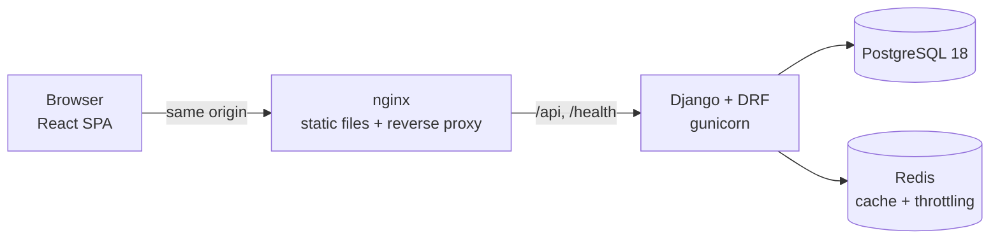

# FlowOps

**English** · [Español](README.es.md)

Multi-tenant approval workflows for operations teams: purchases, expenses and access requests go to
the right approvers, in order, with a record of every decision.

> **Status: feature-complete MVP, not deployed.** Accounts, organizations, people management,
> versioned approval workflows and the full request lifecycle (submit, approve, reject, audit) work
> end to end and run locally with one command. See [Roadmap](#roadmap).

   

## What works today

- **Sign in** with email and password. Sessions are server-side, CSRF-protected (login included), and failed attempts are throttled.
- **Organizations and roles.** Create organizations, switch between the ones you belong to, and see your role (owner, admin or member).
- **Tenant isolation.** Every request runs in the context of one organization. Data from other organizations is unreachable: such requests get `404`.
- **Role-based permissions.** Members read; admins and owners manage people, workflows and settings; only owners manage owners.
- **Invitations.** Admins invite people by email. Links work once, expire after 7 days and only for the invited address; new people create their account when they accept.
- **Member management.** Change roles, remove members or leave an organization. An organization always keeps at least one owner, even under concurrent changes.
- **Workflow templates.** Define who approves each kind of request and in what order, with a visual step builder and live route preview. Templates are versioned: admins edit a draft and publish it, published versions never change, and members only see published routes.
- **Requests and approvals.** Create a draft and submit it; it follows the workflow version it was submitted with, step by step. Approvers decide from their inbox, a rejection needs a reason, and rejected requests can be duplicated into a new draft. Nobody can approve their own request, whatever their role. When two people decide the same step at once, exactly one decision counts and the other person is told.
- **Admin fallback.** If nobody left can decide a step (the approver left or changed role), an admin other than the requester can decide it with a mandatory comment, recorded as an admin decision. Admins are notified when a step loses its last possible approver.
- **People who leave.** Their requests are kept and approvers can still decide them. An admin can cancel such a request while it is in review, with a mandatory reason recorded in the audit log; requests of current members can only be cancelled by their requester.
- **Audit trail.** Request changes, decisions, comments, membership changes and workflow changes are recorded in an append-only log: per request for everyone who can see it, organization-wide for admins.
- **Inbox and notifications.** Steps waiting for you, a count in the navigation, and in-app notifications for assignments, outcomes and comments.
- **Web app.** Responsive React UI with loading, empty, error and permission states, keyboard navigation and automated accessibility checks.
- **Operational basics.** Health and readiness endpoints, JSON logs with request IDs, RFC 9457 error responses, and OpenAPI docs at `/api/docs/`.

## Architecture



| Layer | Responsibility |
|---|---|
| `backend/apps/accounts` | Email-based user model, session login/logout, login throttling |
| `backend/apps/organizations` | Organizations, memberships, roles, tenant resolution, permissions, invitations |
| `backend/apps/workflows` | Workflow templates, versions and approval steps |
| `backend/apps/requests` | Requests, approval tasks, comments, state machine, eligibility policy, inbox |
| `backend/apps/audit` | Append-only audit events and the admin audit API |
| `backend/apps/notifications` | In-app notifications |
| `backend/common` | Problem-details errors, request-ID middleware, JSON logging, health checks |
| `frontend/src` | React app: API client generated from the OpenAPI schema, session and organization context, pages |

Inside each Django app, **views** handle HTTP only, **services** perform writes inside transactions,
and **selectors** perform tenant-scoped reads.

### Technical decisions

- [ADR-0001 Multi-tenancy: shared schema, application-enforced isolation](docs/adr/0001-multi-tenancy.md)
- [ADR-0002 Authentication: server sessions with CSRF for a same-origin SPA](docs/adr/0002-authentication.md)
- [ADR-0003 Runtime and tooling versions](docs/adr/0003-runtime-and-tooling-versions.md)
- [ADR-0004 Invitations and owner protection](docs/adr/0004-invitations-and-owner-protection.md)
- [ADR-0005 Versioned workflow templates instead of a generic workflow engine](docs/adr/0005-versioned-workflow-templates.md)
- [ADR-0006 Request state machine and concurrency control](docs/adr/0006-request-state-machine-and-concurrency.md)
- [ADR-0007 Append-only audit log](docs/adr/0007-append-only-audit-log.md)

## Quick start

Requirements: Docker with Compose v2, and `make`. Running the frontend tests or the end-to-end tests
outside Docker also needs Node.js 22+.

```bash
git clone https://github.com/leonardogr15/flowops.git
cd flowops
make demo   # creates .env with random local secrets, builds, starts, seeds demo data
```

`make` picks `python3`, `python` or `py`, whichever exists. Without `make` (for example on plain
Windows), run the same steps directly:

```bash
python scripts/make_env.py
docker compose up -d --build --wait
docker compose exec api python manage.py seed_demo
```

Open <http://localhost:8080>. API docs: <http://localhost:8080/api/docs/>.

> The Compose stack is a **local demo**: the API runs Django's development server with `DEBUG`
> on, ports are bound to `127.0.0.1`, and cookies are not marked `Secure` because it serves plain
> HTTP. It is not a deployment configuration. The production image (`backend/Dockerfile`, target
> `runtime`) uses gunicorn with `config.settings.prod` and is built in CI. The Django admin is not
> exposed through nginx; locally it is at <http://localhost:8000/admin/>.

### Demo accounts

All demo users share the password stored as `DEMO_PASSWORD` in your generated `.env`. People and
companies are fictional.

| Email | Organization | Role |
|---|---|---|
| `olivia.owner@flowops.test` | Orbital Supplies Co. | Owner |
| `adam.admin@flowops.test` | Orbital Supplies Co. | Admin |
| `maya.member@flowops.test` | Orbital Supplies Co. | Member |
| `raj.approver@flowops.test` | Orbital Supplies Co. / Kestrel Analytics | Member / Admin |
| `kim.owner@flowops.test` | Kestrel Analytics | Owner |

Signing in as Maya and Adam shows the permission differences on the Members, Workflows and Settings
pages. Raj can switch between two organizations. The demo includes a published workflow and a draft,
and requests in every state. To follow an approval end to end, submit a request as Maya, then approve
it as Raj (step 1), Adam (step 2) and Olivia (step 3); each step appears in that person's Inbox.
Invitation emails are printed to the API log (`docker compose logs api`); the invite dialog also shows
the link once.

## API overview

All endpoints are under `/api/v1/`. Unsafe methods need the `X-CSRFToken` header. Tenant-scoped
endpoints need `X-Organization: <organization slug>`.

| Method and path | Auth | Tenant-scoped | Member | Admin | Owner |
|---|---|---|:-:|:-:|:-:|
| `GET /auth/csrf` | none | no | – | – | – |
| `POST /auth/login` · `POST /auth/logout` · `GET /auth/me` | session | no | – | – | – |
| `GET /organizations` (mine) · `POST /organizations` (create, become owner) | session | no | – | – | – |
| `GET /org` | session | yes | yes | yes | yes |
| `PATCH /org` (rename) | session | yes | no (403) | yes | yes |
| `GET /org/members` | session | yes | yes | yes | yes |
| `PATCH /org/members/{id}` (role) · `DELETE /org/members/{id}` | session | yes | leave only | yes¹ | yes |
| `GET /org/invitations` · `POST /org/invitations` · `DELETE /org/invitations/{id}` | session | yes | no (403) | yes | yes |
| `GET /invitations/{token}` · `POST /invitations/{token}/accept` | the token | no | – | – | – |
| `GET /org/workflow-templates` · `GET /org/workflow-templates/{id}` | session | yes | published only | yes | yes |
| `POST /org/workflow-templates` · `PATCH …/{id}` · `PUT …/{id}/draft` · `POST …/{id}/publish` | session | yes | no (403) | yes | yes |
| `GET /org/requests` (`scope`, `status`) · `GET /org/requests/{id}` | session | yes | own and taken part in² | all | all |
| `POST /org/requests` · `PATCH /org/requests/{id}` (draft) · `POST …/{id}/submit` · `…/cancel`⁴ · `…/duplicate` | session | yes | requester | requester | requester |
| `POST /org/requests/{id}/approve` · `…/reject` (body: `step`, `comment`) | session | yes | eligible³ | eligible³ | eligible³ |
| `GET` and `POST /org/requests/{id}/comments` · `GET …/{id}/timeline` | session | yes | if visible | yes | yes |
| `GET /org/inbox`⁵ · `GET /org/notifications` · `GET …/unread` · `POST …/{id}/read` | session | yes | own | own | own |
| `GET /org/audit-events` | session | yes | no (403) | yes | yes |

¹ Admins cannot grant, change or remove the owner role; only owners can. The last owner can never be
demoted or removed (`409`).

² Requests a member created, or where they are or were an approver. Other requests get `404`.

³ The named member, or anyone with the step's role or higher; never the requester. If nobody is
eligible, admins and owners other than the requester decide with a required comment. A stale `step`
or `revision` gets `409`; submitting when a step has no possible approver gets `422`
(`urn:flowops:problem:no_eligible_approver`).

⁴ Admins and owners may also cancel a request in review whose requester is no longer a member, with a
required `reason` that is written to the audit log. For current members' requests they get `403`.

⁵ Returns `{count, results, limit}`: every open task waiting for you is counted, and the oldest
`limit` (200) are listed.

Status codes: `401` if not signed in, `403` if your role is not allowed, `404` for organizations you
don't belong to (indistinguishable from ones that don't exist), and `400` if the organization header
is missing. Errors use `application/problem+json`.

## Security

| Control | Where |
|---|---|
| Session cookie `HttpOnly`, `SameSite=Lax`, `Secure` outside local dev | `config/settings/base.py` |
| CSRF on every unsafe request, including login | `apps/accounts/api/views.py` |
| Argon2 password hashing, minimum length 12 | `config/settings/base.py` |
| Generic error for unknown email, wrong password and inactive user | `LoginView` |
| Login throttling per (client IP, email) and per client IP across all emails, with a trusted proxy count so `X-Forwarded-For` can't be spoofed; emails are hashed in throttle keys | `apps/accounts/throttles.py`, `NUM_PROXIES` |
| Cross-tenant requests return 404; isolation harness covers every endpoint, including object ids from another organization | `apps/organizations/tests/test_isolation.py` |
| Invitation tokens: 256-bit random, stored only as SHA-256, single use, 7-day expiry, bound to the invited email; re-inviting revokes the previous link | `apps/organizations/members.py` |
| Invitation tokens never reach the logs: Django log lines, the nginx access log (path and `Referer`) and error messages show `[redacted]`; gunicorn's access log is off (Django logs every request). CI fails if a raw token appears in the end-to-end stack's logs | `common/redaction.py`, `frontend/nginx.conf`, `.github/workflows/ci.yml` |
| Sending invitations (30 per hour) and creating organizations (5 per hour) are limited per user, so an account can't be used to send bulk email; limits answer `429` with `Retry-After` | `common/throttling.py`, `config/settings/base.py` |
| Role changes re-read the acting member and lock owner rows, so concurrent demotions cannot remove the last owner | `apps/organizations/members.py` |
| Request transitions run under row locks in a fixed order (template, request, open task). Decisions carry the current step and submits the current revision, so double clicks, retries and simultaneous decisions apply once | `apps/requests/services.py`, ADR-0006 |
| Requesters never decide their own request, including admins and owners; admin fallback needs a comment and is flagged in the audit log | `apps/requests/policy.py` |
| Audit events are written in the same transaction as the change; a model guard and a PostgreSQL trigger block updates and deletes (tamper-resistant, not cryptographically immutable). Events of a request are numbered under the request's row lock, so the timeline keeps their logical order even if the server clock steps back | `apps/audit/`, ADR-0007 |
| Request visibility is enforced in queries: people outside a request get `404`, and notifications about requests they can no longer see are hidden | `apps/requests/policy.py`, `apps/notifications/` |
| Published workflow versions are immutable (enforced in services and in the model); publishing re-checks that approvers are still members | `apps/workflows/` |
| Production settings refuse to start without an explicit `EMAIL_BACKEND`, so invitation links are never written to logs by the local console backend | `config/settings/prod.py` |
| Deny-by-default permissions; role checks on the server, never only in the UI | `apps/organizations/permissions.py` |
| UUIDv7 public IDs (no sequential IDs in URLs) | `common/models.py` |
| CSP (including `object-src 'none'`), `X-Frame-Options`, `nosniff`, `Referrer-Policy` on every response; Django admin not routed through the public entrypoint | `frontend/security-headers.conf`, `frontend/nginx.conf` |
| Containers run as non-root; secrets only via environment | `Dockerfile`s, `.env.example` |
| Secret scanning of the full git history and the working tree in CI | `.github/workflows/ci.yml` (gitleaks) |

To report a vulnerability, see [SECURITY.md](SECURITY.md).

## Testing

| Suite | Command | What it covers |
|---|---|---|
| Backend | `make test-api` | Auth, CSRF, throttling, tenancy, permission matrices, cross-tenant isolation, invitations, last-owner protection under concurrency, workflow versioning, request state machine, simultaneous decisions on real PostgreSQL, self-approval, admin fallback, audit trigger and rollback. Coverage gate: 85% |
| Backend lint/types | `make lint-api` | ruff, mypy (strict, with Django and DRF plugins) |
| Frontend | `make test-web` | Sign-in, redirects, organization switching, settings, members and roles, invitations and acceptance, workflow builder and publishing, requests (create, submit, approve, reject, lost race), inbox, notifications, audit log, axe accessibility checks |
| Frontend lint/types | `make lint-web` | oxlint (warnings fail), TypeScript strict |
| End-to-end | `make e2e-up`, then `make e2e` | Playwright on desktop and mobile viewports against the real stack: sign-in, an expired session that returns to the same page, invite and join, build and publish a workflow, a request approved by Raj, Adam and Olivia with its full audit trail, rejection and duplication, self-approval refused in the UI and the API, two admins deciding the same step at once |
| Contract | `make schema-check` | Committed OpenAPI schema matches the code; generated TypeScript types match the schema (CI) |

The CI workflow (`.github/workflows/ci.yml`) is configured to run all of the above on every push and pull request, plus gitleaks over the full history.

`make e2e-up` starts a separate Compose project (`flowops-e2e`, with its own database) from
`docker-compose.e2e.yml`, so test data never mixes with the demo; stop the demo first (`make down`),
because both use the same ports. The API runs the production image under gunicorn, without the source
bind mount or the development autoreloader, so editing files while the suite runs cannot restart the
server mid-test. `make e2e` reads `DEMO_PASSWORD` from `.env`. `make e2e-reset` deletes only the
end-to-end database. Run `make web-install` once before the frontend and end-to-end targets; `make
help` lists every target.

## Project layout

```
backend/        Django project (config/, apps/, common/), openapi.yaml, Dockerfile
frontend/       React app (src/), Playwright tests (e2e/), nginx config, Dockerfile
docs/adr/       Architecture decision records
scripts/        Local helper scripts
```

## Roadmap

| Milestone | Scope | Status |
|---|---|---|
| Foundation | Accounts, organizations, tenancy, permissions, app shell | **Done** |
| People | Invitations by email, member management, last-owner protection | **Done** |
| Workflows | Versioned workflow templates with ordered approval steps | **Done** |
| Requests | Submit, approve, reject, comment; state machine with concurrency safety; audit trail; in-app notifications | **Done** |
| Notifications | Email notifications | Planned |
| Hardening | PostgreSQL Row-Level Security, OIDC sign-in, rate limits per tenant | Later |

## License

[MIT](LICENSE) © 2026 Leonardo Galvis
