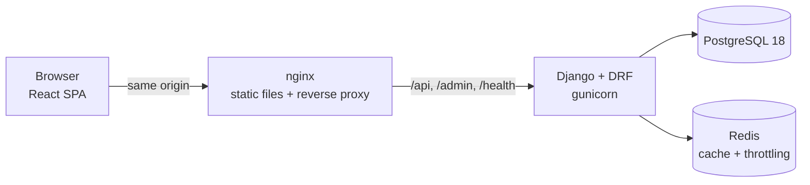

# FlowOps

Multi-tenant approval workflows for operations teams: purchases, expenses and access requests go to
the right approvers, in order, with a record of every decision.

> **Status: early development.** This release covers the foundation: accounts, organizations,
> tenant isolation and role-based permissions, with a working web app. Approval workflows are the
> next milestone; see [Roadmap](#roadmap).

   

## What works today

- **Sign in** with email and password. Sessions are server-side, CSRF-protected (login included), and failed attempts are throttled.
- **Organizations and roles.** Create organizations, switch between the ones you belong to, and see your role (owner, admin or member).
- **Tenant isolation.** Every request runs in the context of one organization. Data from other organizations is unreachable: such requests get `404`.
- **Role-based permissions.** Members read; admins and owners manage organization settings.
- **Web app.** Responsive React UI with loading, empty, error and permission states, keyboard navigation and automated accessibility checks.
- **Operational basics.** Health and readiness endpoints, JSON logs with request IDs, RFC 9457 error responses, and OpenAPI docs at `/api/docs/`.

## Architecture



| Layer | Responsibility |
|---|---|
| `backend/apps/accounts` | Email-based user model, session login/logout, login throttling |
| `backend/apps/organizations` | Organizations, memberships, roles, tenant resolution, permissions |
| `backend/common` | Problem-details errors, request-ID middleware, JSON logging, health checks |
| `frontend/src` | React app: API client generated from the OpenAPI schema, session and organization context, pages |

Inside each Django app, **views** handle HTTP only, **services** perform writes inside transactions,
and **selectors** perform tenant-scoped reads.

### Technical decisions

- [ADR-0001 Multi-tenancy: shared schema, application-enforced isolation](docs/adr/0001-multi-tenancy.md)
- [ADR-0002 Authentication: server sessions with CSRF for a same-origin SPA](docs/adr/0002-authentication.md)
- [ADR-0003 Runtime and tooling versions](docs/adr/0003-runtime-and-tooling-versions.md)

## Quick start

Requirements: Docker with Compose v2, and `make`. Running the frontend tests or the end-to-end tests
outside Docker also needs Node.js 22+.

```bash
git clone https://github.com/leonardogr15/flowops.git
cd flowops
make demo   # creates .env with random local secrets, builds, starts, seeds demo data
```

Without `make` (for example on Windows), run the same steps directly:

```bash
python scripts/make_env.py
docker compose up -d --build --wait
docker compose exec api python manage.py seed_demo
```

Open <http://localhost:8080>. API docs: <http://localhost:8080/api/docs/>.

### Demo accounts

All demo users share the password stored as `DEMO_PASSWORD` in your generated `.env`. People and
companies are fictional.

| Email | Organization | Role |
|---|---|---|
| `olivia.owner@flowops.test` | Orbital Supplies Co. | Owner |
| `adam.admin@flowops.test` | Orbital Supplies Co. | Admin |
| `maya.member@flowops.test` | Orbital Supplies Co. | Member |
| `raj.approver@flowops.test` | Orbital Supplies Co. / Kestrel Analytics | Member / Admin |
| `kim.owner@flowops.test` | Kestrel Analytics | Owner |

Signing in as Maya and Adam shows the permission difference on the Settings page. Raj can switch
between two organizations.

## API overview

All endpoints are under `/api/v1/`. Unsafe methods need the `X-CSRFToken` header. Tenant-scoped
endpoints need `X-Organization: <organization slug>`.

| Method and path | Auth | Tenant-scoped | Member | Admin | Owner |
|---|---|---|:-:|:-:|:-:|
| `GET /auth/csrf` | none | no | – | – | – |
| `POST /auth/login` · `POST /auth/logout` · `GET /auth/me` | session | no | – | – | – |
| `GET /organizations` (mine) · `POST /organizations` (create, become owner) | session | no | – | – | – |
| `GET /org` | session | yes | yes | yes | yes |
| `PATCH /org` (rename) | session | yes | no (403) | yes | yes |
| `GET /org/members` | session | yes | yes | yes | yes |

Status codes: `401` if not signed in, `403` if your role is not allowed, `404` for organizations you
don't belong to (indistinguishable from ones that don't exist), and `400` if the organization header
is missing. Errors use `application/problem+json`.

## Security

| Control | Where |
|---|---|
| Session cookie `HttpOnly`, `SameSite=Lax`, `Secure` outside local dev | `config/settings/base.py` |
| CSRF on every unsafe request, including login | `apps/accounts/api/views.py` |
| Argon2 password hashing, minimum length 12 | `config/settings/base.py` |
| Generic error for unknown email, wrong password and inactive user | `LoginView` |
| Login throttling per client IP and email, with a trusted proxy count so `X-Forwarded-For` can't be spoofed | `apps/accounts/throttles.py`, `NUM_PROXIES` |
| Cross-tenant requests return 404; isolation harness covers every endpoint | `apps/organizations/tests/test_isolation.py` |
| Deny-by-default permissions; role checks on the server, never only in the UI | `apps/organizations/permissions.py` |
| UUIDv7 public IDs (no sequential IDs in URLs) | `common/models.py` |
| CSP, `X-Frame-Options`, `nosniff`, `Referrer-Policy` on every response | `frontend/security-headers.conf` |
| Containers run as non-root; secrets only via environment | `Dockerfile`s, `.env.example` |
| Secret scanning of the full git history and the working tree in CI | `.github/workflows/ci.yml` (gitleaks) |

To report a vulnerability, see [SECURITY.md](SECURITY.md).

## Testing

| Suite | Command | What it covers |
|---|---|---|
| Backend | `make test-api` | Auth, CSRF, throttling, tenancy, permission matrix, cross-tenant isolation, health and errors. Coverage gate: 85% |
| Backend lint/types | `make lint-api` | ruff, mypy (strict, with Django and DRF plugins) |
| Frontend | `make test-web` | Sign-in flow, redirects, organization switching, admin and member settings, axe accessibility checks |
| Frontend lint/types | `make lint-web` | oxlint (warnings fail), TypeScript strict |
| End-to-end | `make e2e` (stack running, `DEMO_PASSWORD` exported) | Playwright on desktop and mobile viewports against the real stack |
| Contract | `make schema-check` | Committed OpenAPI schema matches the code; generated TypeScript types match the schema (CI) |

CI runs all of the above on every push and pull request, plus gitleaks over the full history.

## Project layout

```
backend/        Django project (config/, apps/, common/), openapi.yaml, Dockerfile
frontend/       React app (src/), Playwright tests (e2e/), nginx config, Dockerfile
docs/adr/       Architecture decision records
scripts/        Local helper scripts
```

## Roadmap

| Milestone | Scope | Status |
|---|---|---|
| Foundation | Accounts, organizations, tenancy, permissions, app shell | **Done** |
| People | Invitations by email, member management, last-owner protection | Next |
| Workflows | Versioned workflow templates with ordered approval steps | Planned |
| Requests | Submit, approve, reject, comment; state machine with concurrency safety; audit trail | Planned |
| Notifications | In-app and email notifications | Planned |
| Hardening | PostgreSQL Row-Level Security, OIDC sign-in, rate limits per tenant | Later |

## License

[MIT](LICENSE) © 2026 Leonardo Galvis
